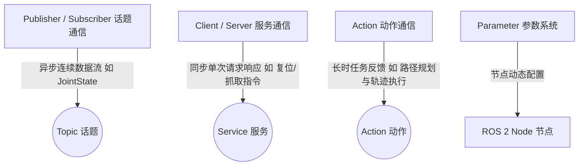

# 阶段一：ROS 2 基础、TF2 坐标树与 URDF/XACRO 建模精通讲义

> **定位说明**：本讲义专为**完全掌握阶段一（零基础到彻底啃透）**设计。不回避任何技术细节，手把手从 ROS 2 架构、XML 语法、坐标变换数学到命令行调试，帮助你建立扎实的机器人工程底座。

---

## 目录
1. [ROS 2 基础架构与工作空间原理](#1-ros-2-基础架构与工作空间原理)
2. [URDF 与 XACRO 机器人描述建模保姆级解剖](#2-urdf-与-xacro-机器人描述建模保姆级解剖)
3. [TF2 坐标变换树机制与数学原理](#3-tf2-坐标变换树机制与数学原理)
4. [自测问答详解与概念辨析](#4-自测问答详解与概念辨析)
5. [阶段一动手实验与验证 Checklist](#5-阶段一动手实验与验证-checklist)

---

## 1. ROS 2 基础架构与工作空间原理

### 1.1 工作空间结构 (Workspace Anatomy)
在 `/home/freebird/AntigraProj/Arm_Grabbing` 工作空间中：

```text
Arm_Grabbing/
├── src/       # 源码目录（我们编写的 ROS 2 功能包放入此处）
├── build/     # 编译中间产物（CMake / setuptools 产生的临时构建文件）
├── install/   # 编译安装产物（编译后的可执行文件、Python 包、Launch 文件与 Mesh 资源）
└── log/       # 编译与运行日志
```

### 1.2 编译与环境加载流程
- **编译命令**：`colcon build`
  - 作用：遍历 `src/` 下的所有 ROS 2 功能包（检查 `package.xml` 和 `CMakeLists.txt` 或 `setup.py`），将其编译并安装到 `install/` 目录。
- **环境加载**：`source install/setup.bash`
  - 作用：将 `install/` 目录下的可执行路径、Python 库路径以及 ROS 2 资源路径添加到当前 Shell 的环境变量（`PATH`, `PYTHONPATH`, `AMENT_PREFIX_PATH`）中，使系统能够通过 `ros2 run` 或 `ros2 launch` 找到功能包。

### 1.3 ROS 2 通信四大核心概念



1. **Topic（话题通信 - 异步单向）**：
   - 特点：广播/订阅模式，适于发布高频连续传感器数据（如电机当前角度 `/joint_states`、摄像头图像 `/camera/image_raw`）。
2. **Service（服务通信 - 同步双向）**：
   - 特点：请求/响应模式，适用于一次性控制指令（如开启舵机使能、传感器清零）。
3. **Action（动作通信 - 长时反馈）**：
   - 特点：包含目标 (Goal)、反馈 (Feedback) 和结果 (Result)，适用于耗时较长、中途需要监控进度的任务（如 MoveIt 2 执行一段轨迹）。
4. **Parameter（参数系统）**：
   - 特点：节点的配置变量（如底座串口波特率 `1000000`、PID 参数），可在运行时动态修改。

---

## 2. URDF 与 XACRO 机器人描述建模保姆级解剖

### 2.1 为什么使用 XACRO 而非纯 URDF？
- **纯 URDF** 只能写死静态 XML 代码，无法使用变量、数学表达式和模块化复用。
- **XACRO (XML Macros)** 是 URDF 的宏扩展语言，支持：
  - **常量定义**：`<xacro:property name="M_PI" value="3.141592653589793"/>`
  - **数学运算**：`<origin xyz="${1.0/2.0} 0 0"/>`
  - **模块复用**：定义一个关节宏，批量生成左右两条腿/多个手指。

在 `so_arm101.urdf.xacro` 顶部，第一行通过 `<robot xmlns:xacro="...">` 声明了 XACRO 命名空间。

---

### 2.2 核心标签一：`<link>`（连杆/构件）

Link 代表机器人上的一个**刚体零件**。它包含三个独立且重要的子标签：

```xml
<link name="shoulder_link">
  <!-- 1. inertial: 动力学参数（质量、质心偏移与转动惯量） -->
  <inertial>
    <origin xyz="-0.0307604 -1.66727e-05 -0.0252713" rpy="0 0 0"/>
    <mass value="0.100006"/> <!-- 质量 m (kg) -->
    <!-- 3x3 惯量张量矩阵的 6 个独立元素 (kg*m^2) -->
    <inertia ixx="8.3759e-05" ixy="7.55525e-08" ixz="-1.16342e-06" 
             iyy="8.10403e-05" iyz="1.54663e-07" izz="2.39783e-05"/>
  </inertial>

  <!-- 2. visual: 视觉模型（给 RViz 2 渲染好看的 3D 外观） -->
  <visual>
    <origin xyz="-0.0303992 0.000422241 -0.0417" rpy="1.5708 1.5708 0"/>
    <geometry>
      <mesh filename="package://so_arm101_description/meshes/sts3215_03a_v1.stl"/>
    </geometry>
    <material name="sts3215"/>
  </visual>

  <!-- 3. collision: 碰撞外壳模型（物理引擎物理碰撞与 MoveIt 2 避障规划） -->
  <collision>
    <origin xyz="-0.0303992 0.000422241 -0.0417" rpy="1.5708 1.5708 0"/>
    <geometry>
      <mesh filename="package://so_arm101_description/meshes/sts3215_03a_v1.stl"/>
    </geometry>
  </collision>
</link>
```

#### 关键问答：`visual` 与 `collision` 的区别是什么？
- **`visual`**：纯外观，相当于机器人的“外衣”。你可以使用高精度的 STL/DAE 3D 网格文件，贴上精致纹理。它**只参与显卡渲染，不参与物理碰撞**。
- **`collision`**：物理外壳，相当于机器人的“碰撞箱”。为了保证物理仿真（Gazebo / MuJoCo）或碰撞检测（OMPL / FCL）在 1000Hz 高频下的计算效率，`collision` 通常采用**简化几何体**（如圆柱体、长方体、包围盒）或简化 STL。如果不写 `collision`，机械臂在物理仿真中会直接穿透地面或穿透物体落下去！

---

### 2.3 核心标签二：`<joint>`（关节/连接）

Joint 描述了父连杆（`parent`）与子连杆（`child`）之间的运动约束。

```xml
<joint name="shoulder_pan" type="revolute">
  <!-- 1. 相对位姿偏移：子坐标系原点相对于父坐标系原点的 (x,y,z) 距离与 (rpy) 旋转 -->
  <origin xyz="0.0388353 -8.97657e-09 0.0624" rpy="3.14159 4.18253e-17 -3.14159"/>
  
  <parent link="base_link"/>      <!-- 父连杆：底座 -->
  <child link="shoulder_link"/>   <!-- 子连杆：肩部构件 -->
  
  <!-- 2. 旋转轴方向向量：在子坐标系下，绕哪根轴旋转 -->
  <axis xyz="0 0 1"/>            <!-- 绕局部 Z 轴旋转 -->
  
  <!-- 3. 物理限制：最大转矩 (N*m)、最大转速 (rad/s)、旋转角下限与上限 (rad) -->
  <limit effort="10" velocity="10" lower="-1.91986" upper="1.91986"/>
</joint>
```

#### Joint 的常见类型 (`type`)：
1. **`revolute`**：旋转关节，旋转范围受 `lower` 和 `upper` 限制（如肘关节只能弯曲 $-100^\circ \sim +100^\circ$）。
2. **`continuous`**：连续旋转关节，无角度限制（如车轮、风扇转轴）。
3. **`prismatic`**：直线移动/滑动关节，沿指定轴平移（如电缸、三轴数控机床的 X/Y/Z 轴）。
4. **`fixed`**：固定关节，父子连杆焊死相对不动（如机械臂末端安装的传感器、`gripper_frame_link` 虚拟标定点）。

---

## 3. TF2 坐标变换树机制与数学原理

### 3.1 齐次变换矩阵 $T \in SE(3)$
在三维空间中，一个连杆坐标系相对于另一个连杆坐标系的位姿变换由一个 $4 \times 4$ 齐次变换矩阵描述：

$$T = \begin{bmatrix} R_{3 \times 3} & p_{3 \times 1} \\ 0_{1 \times 3} & 1 \end{bmatrix}$$

- $R_{3 \times 3}$：三维旋转矩阵，由 Roll-Pitch-Yaw 姿态决定；
- $p_{3 \times 1}$：三维平移向量 $[x, y, z]^T$。

当机械臂拥有多个关节时，从底座 `base_link` 到末端 `gripper_frame_link` 的总变换矩阵为各个 Joint 变换矩阵的连乘：

$$T_{\text{base}}^{\text{gripper}} = T_{\text{base}}^{\text{shoulder}}(q_1) \cdot T_{\text{shoulder}}^{\text{upper\_arm}}(q_2) \cdot T_{\text{upper\_arm}}^{\text{lower\_arm}}(q_3) \cdot T_{\text{lower\_arm}}^{\text{wrist}}(q_4) \cdot T_{\text{wrist}}^{\text{gripper}}(q_5) \cdot T_{\text{gripper}}^{\text{frame}}$$

### 3.2 ROS 2 中的 TF2 工作原理
1. **`robot_state_publisher` 节点**：读取 URDF 文件的静态 `<origin>` 偏移，同时订阅关节当前角度话题 `/joint_states`。
2. **坐标计算与广播**：根据关节实时角度 $q_1, q_2, \dots, q_5$，计算上述矩阵连乘结果，并按 50Hz 频率在 `/tf` 和 `/tf_static` 话题广播变换树。
3. **坐标查询**：任何其他节点（如运动学求解器、MoveIt 2、视觉节点）都可以直接向 TF2 查询任意两个 Link 之间的实时相对距离与姿态。

---

## 4. 自测问答详解与概念辨析

### ❓ 问题 1：`<limit lower="0.0" upper="1.5708"/>` 代表的角度范围是多少？
- **解答**：
  URDF 中所有的角度单位强制为**弧度 (Radian)**。
  换算公式：$\text{角度 (degree)} = \text{弧度 (rad)} \times \frac{180}{\pi}$。
  - `lower="0.0"` $\to 0^\circ$（起始位）；
  - `upper="1.5708"` $\to 1.5708 \times \frac{180}{3.1415926} \approx 90^\circ$。
  - **结论**：该关节允许的物理旋转角度为 **$0^\circ$ 到 $90^\circ$**（正向直角旋转）。

---

### ❓ 问题 2：`visual` 与 `collision` 的区别是什么？
- **解答**：
  - **`visual`（外观）**：用于 RViz 2 屏幕显示渲染。支持细腻的 3D 模型和彩色材质。不参与任何物理碰撞计算。
  - **`collision`（碰撞箱）**：用于 Gazebo / MuJoCo 物理引擎和 MoveIt 2 避障。通常是简化的几何体，追求高计算效率。如果不定义 `collision`，物理仿真中机械臂会直接穿透地面落入无底深渊。

---

## 5. 阶段一动手实验与验证 Checklist

请在终端中执行以下验证步骤，确认掌握：

### 步骤 1：编译并拉起可视化节点
```bash
cd /home/freebird/AntigraProj/Arm_Grabbing

eval "$(conda shell.bash hook)" && conda deactivate 2>/dev/null || true
source /opt/ros/humble/setup.bash
source install/setup.bash

# 启动 RViz 2 和关节滑动条
ros2 launch so_arm101_description display.launch.py
```

### 步骤 2：在终端实时监听关节角度话题
另开一个终端：
```bash
source /opt/ros/humble/setup.bash
ros2 topic echo /joint_states
```
在 GUI 界面拖动滑块，观察终端中输出的 `position` 数组数值是否实时变化。

### 步骤 3：使用 TF2 命令行工具查询实时坐标
```bash
source /opt/ros/humble/setup.bash
ros2 run tf2_ros tf2_echo base_link gripper_frame_link
```
观察终端输出的 `Translation: [x, y, z]` 与 `Rotation: [x, y, z, w]`。
